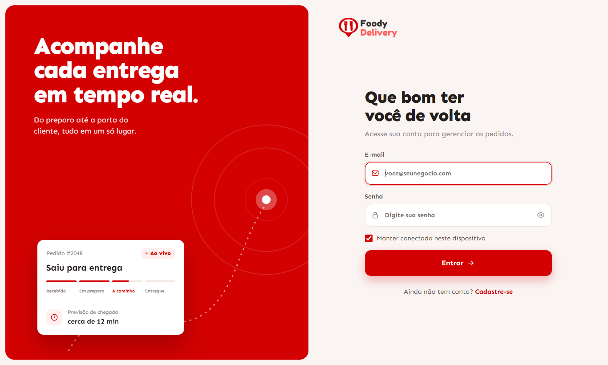
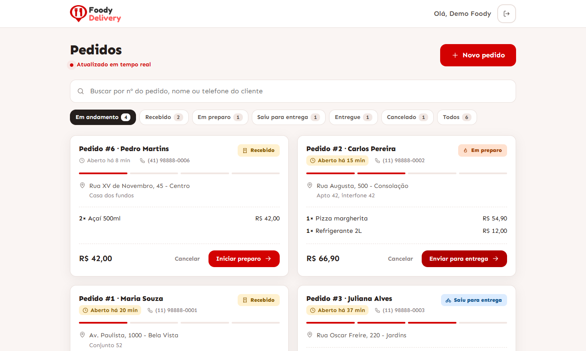
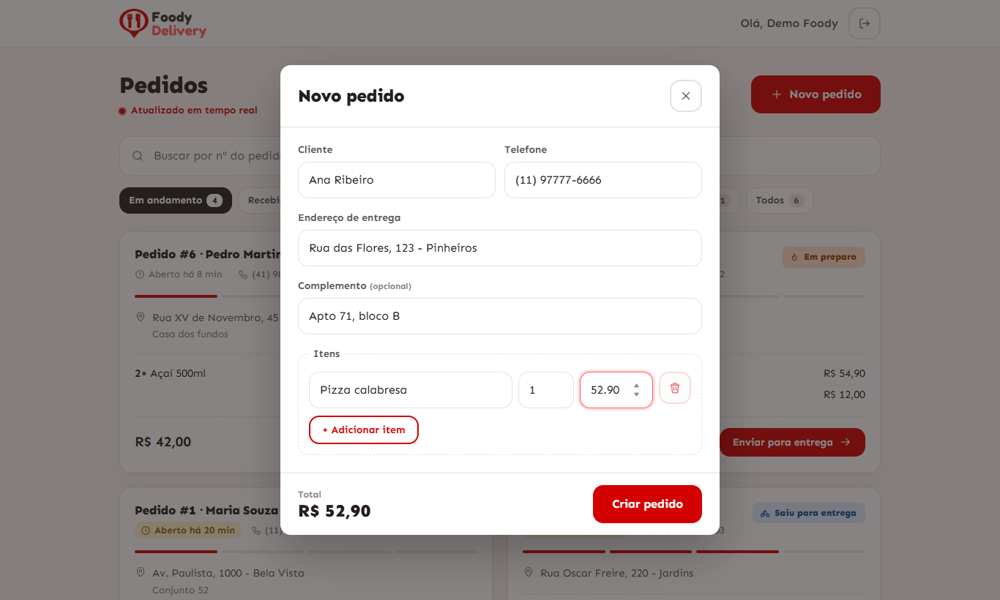

# Foody Delivery - Mini Rastreador de Pedidos


Versão simplificada de um sistema de rastreamento de pedidos de delivery: cadastro e login, criação de pedidos, acompanhamento por status e uma lista que se atualiza sozinha.

## Demo online

| | |
|---|---|
| Aplicação | https://foody-delivery-test.vercel.app |
| API (Swagger) | https://foody-api-thm8.onrender.com/swagger-ui.html |
| Usuário de teste | `demo@foody.com` / `demo123` |

O back-end roda no plano gratuito do Render: o primeiro acesso depois de um período parado pode levar cerca de 1 minuto para acordar (a tela avisa), e os dados de teste são reiniciados nesses casos. Para rodar tudo na sua máquina, veja [Como rodar](#como-rodar).

| Login | Pedidos |
|---|---|
|  |  |



## Sumário

- [Demo online](#demo-online)
- [Stack](#stack)
- [Como rodar](#como-rodar)
- [Usuário de teste](#usuário-de-teste)
- [API e Swagger](#api-e-swagger)
- [Regras de status](#regras-de-status)
- [Arquitetura](#arquitetura)
- [Decisões e trade-offs](#decisões-e-trade-offs)
- [Testes](#testes)
- [O que eu faria com mais tempo](#o-que-eu-faria-com-mais-tempo)

## Stack

**Back-end:** Java 21, Spring Boot 4.1, Spring Security com JWT (jjwt) e BCrypt, Spring Data JPA, Bean Validation, Flyway, SQLite, springdoc-openapi (Swagger UI), JUnit 5, Mockito e MockMvc.

**Front-end:** React 19, TypeScript, Vite, React Router e Axios, com CSS próprio baseado nas cores e na fonte (Sen) da Foody, e Vitest com Testing Library nos testes.

## Como rodar

### Com Docker (recomendado)

```bash
docker compose up --build
```

| Serviço | URL |
|---|---|
| Aplicação | http://localhost:3000 |
| API | http://localhost:8080 |
| Swagger UI | http://localhost:8080/swagger-ui.html |

O banco SQLite fica no volume `foody-data`. Para recomeçar do zero: `docker compose down -v`.

### Sem Docker

Pré-requisitos: Java 21 e Node 22.

```bash
cd backend
./mvnw spring-boot:run
```

No Windows use `mvnw.cmd spring-boot:run`. O banco `backend/foody.db` é criado na primeira execução; apague o arquivo para recomeçar.

Em outro terminal:

```bash
cd frontend
npm install
npm run dev
```

A aplicação abre em http://localhost:5173 e o Vite encaminha `/api` para `http://localhost:8080`.

### Variáveis de ambiente

| Variável | Padrão | Uso |
|---|---|---|
| `SPRING_PROFILES_ACTIVE` | `dev` | `dev` cria o usuário de teste e pedidos de exemplo; use `prod` para não criar nada |
| `JWT_SECRET` | valor de desenvolvimento | segredo de assinatura do JWT (mínimo de 32 caracteres); troque em produção |
| `DB_PATH` | `foody.db` | caminho do arquivo SQLite |
| `CORS_ORIGINS` | `http://localhost:5173` | origens permitidas, separadas por vírgula |
| `PORT` | `8080` | porta do servidor (plataformas como o Render definem esta variável) |
| `VITE_API_URL` | vazio | origem da API no front-end, sem `/api` no fim (ex.: `https://foody-api.onrender.com`); vazio usa `/api` no mesmo domínio, via proxy |
| `VITE_PROXY_TARGET` | `http://localhost:8080` | destino do proxy do Vite em desenvolvimento |

## Usuário de teste

Criado automaticamente no perfil `dev`, junto com seis pedidos de exemplo em todos os status:

| E-mail | Senha |
|---|---|
| `demo@foody.com` | `demo123` |

Também é possível criar outra conta na tela de cadastro.

## API e Swagger

Documentação interativa em http://localhost:8080/swagger-ui.html. Faça login em `POST /api/auth/login`, copie o `token`, clique em **Authorize** e cole o token (sem o prefixo `Bearer`).

| Método | Rota | Resposta |
|---|---|---|
| `POST` | `/api/auth/register` | `201` com token e usuário; `409` se o e-mail já existe |
| `POST` | `/api/auth/login` | `200` com token e usuário; `401` se as credenciais forem inválidas |
| `POST` | `/api/orders` | `201` com o pedido e o header `Location` |
| `GET` | `/api/orders?status=&q=&page=&size=` | `200` paginado, do mais novo para o mais antigo |
| `GET` | `/api/orders/summary?q=` | `200` com a contagem de pedidos por status |
| `GET` | `/api/orders/{id}` | `200` ou `404` |
| `PATCH` | `/api/orders/{id}/status` | `200`, `409` se a transição for inválida |

Detalhes da listagem:

- `status` pode se repetir (`?status=RECEBIDO&status=EM_PREPARO`).
- `q` busca por nome do cliente, número do pedido (`12` ou `#12`) e dígitos do telefone, independente da formatação.
- `size` assume 20 por padrão e é limitado a 100.

Todas as rotas, exceto `/api/auth/**` e a documentação, exigem `Authorization: Bearer <token>`. Os erros seguem o formato `ProblemDetail` (RFC 7807); erros de validação trazem também `fieldErrors`.

## Regras de status

```
RECEBIDO -> EM_PREPARO -> SAIU_PARA_ENTREGA -> ENTREGUE
   |             |
   +-> CANCELADO <-+            CANCELADO -> RECEBIDO (restaurar)
```

- O enunciado lista os status, mas não as transições; as regras ficam no enum `OrderStatus` e são aplicadas pela própria entidade `Order`, nunca pelo controller.
- Um pedido **não pode ser cancelado depois que saiu para entrega**: o entregador já está a caminho.
- `ENTREGUE` é final.
- Um pedido cancelado pode ser **restaurado** para `RECEBIDO`, para corrigir cancelamentos feitos por engano.
- Transição inválida responde `409 Conflict`. Cada mudança é registrada em `order_status_history` e aparece em `history` na resposta.

## Arquitetura

Monorepo com um projeto por camada:

```
backend/
  src/main/java/com/foody/tracker/
    auth/      cadastro, login, JWT e filtro de autenticação
    user/      entidade e repositório de usuários
    order/     entidade, regras de status, serviço, controller e DTOs
    seed/      usuário e pedidos de demonstração (perfil dev)
    common/    tratamento global de erros e paginação
    config/    segurança, CORS e OpenAPI
  src/main/resources/db/migration/   migrations do Flyway
frontend/
  src/
    api/         cliente HTTP, sessão e chamadas da API
    features/    auth e orders: páginas, componentes e hooks de cada funcionalidade
    components/  ui (blocos reutilizáveis) e layout
    routes/      rotas e guardas de autenticação
    hooks/, lib/ utilidades compartilhadas
docker-compose.yml
```

## Decisões e trade-offs

- **Total calculado no servidor, em `BigDecimal`.** O front nunca envia o total; o preço nunca passa por `double`.
- **Flyway com `ddl-auto=validate`.** O esquema é versionado em SQL e o Hibernate apenas confere se as entidades batem com ele. No SQLite o autoincremento só existe em `INTEGER PRIMARY KEY`, então os `id` `Long` são mapeados como `INTEGER` no JDBC para passar na validação.
- **SQLite com um único `Connection` no pool.** Evita `database is locked` e atende bem ao desafio; em produção eu trocaria por PostgreSQL, e as migrations seriam o ponto de partida.
- **JWT com `jjwt` e um filtro próprio**, sem sessão no servidor. A alternativa, `oauth2-resource-server`, eliminaria o filtro; mantive a implementação explícita, coberta por testes, e consideraria a troca ao evoluir a segurança.
- **Listagem paginada, filtrada e buscada no servidor**, com um endpoint de contagens. O front mantém só a página carregada e tem "Carregar mais"; as contagens dos filtros vêm da API e respeitam a busca.
- **Atualização por polling a cada 10 segundos**, pausado com a aba oculta. É simples e robusto para o escopo; com mais tempo eu usaria Server-Sent Events.
- **Histórico de status em tabela própria**, preenchido pela entidade a cada transição, em vez de apenas `updatedAt`.
- **Todo usuário autenticado vê todos os pedidos.** O enunciado pede "listar todos"; não há multi-loja nem perfis.
- **Logout apenas no cliente.** Com JWT sem estado, o token continua válido até expirar (8 horas).
- **Perfil `dev` por padrão** cria o usuário de teste. Em produção, `SPRING_PROFILES_ACTIVE=prod` desliga isso.
- **Identidade visual da Foody:** fonte Sen e vermelho `#D30101`, extraídos do CSS do site oficial.

## Testes

```bash
cd backend && ./mvnw test
cd frontend && npm run lint && npm test && npm run build
```

O GitHub Actions roda os dois conjuntos a cada push.

**Back-end, 42 testes:**

- unitários da máquina de estados (`OrderStatusTest`);
- unitários do serviço com Mockito (`OrderServiceTest`);
- de integração com MockMvc para autenticação, pedidos, transições, histórico, busca, filtro, paginação e contagens, rodando as mesmas migrations do Flyway em um SQLite em memória;
- do seed de demonstração.

**Front-end, 62 testes:**

- unitários dos helpers (telefone, WhatsApp, duração, moeda), da sessão (`localStorage` ou `sessionStorage`) e do debounce;
- de componente do cartão do pedido (destaque após 10 minutos, link do WhatsApp, ações por status e dica do histórico);
- de página para a lista (filtros, contagens vindas do servidor, busca, "Carregar mais", confirmação de cancelamento, erros) e para o login;
- das guardas de rota.

## O que eu faria com mais tempo

- Testes ponta a ponta (Playwright) do fluxo de login, criação e mudança de status.
- Atualização em tempo real com Server-Sent Events em vez de polling.
- Fotos de comprovante de entrega, guardadas em um bucket S3 com URLs assinadas.
- Perfis de acesso (atendente, entregador, gerente) e pedidos associados a uma loja.
- Refresh token, bloqueio de tentativas de login e revogação de sessão.
- PostgreSQL, CI no GitHub Actions, observabilidade (Actuator e métricas) e versionamento da API.
- Validação dos formulários com um schema compartilhado (Zod) e mensagens de erro por campo.
- Notificação ao cliente a cada mudança de status.
